<h1 align="center">Hi 👋, I'm Sagar Yadav</h1>
<h3 align="center">AI/ML Engineer & Python Developer | India 🇮🇳</h3>

  

  
  

---

## 👨‍💻 About Me

B.Tech CSE student and aspiring AI/ML engineer. I build intelligent, data-driven applications with Python, from data analysis and machine learning to deep learning, RAG and deployed Streamlit apps.

- 🔭 **Currently working on:** [Presence.ai](https://github.com/sy8600209-prog/Presence.ai)
- 🌱 **Currently learning:** Advanced Machine Learning, Deep Learning & RAG
- 👯 **Looking to collaborate on:** [Presence.ai](https://github.com/sy8600209-prog/Presence.ai)
- 💬 **Ask me about:** Machine Learning, Deep Learning, Python, Streamlit
- 📫 **Reach me at:** sy8600209@gmail.com

---

## 🚀 Featured Project

### 🎓 [Presence.ai](https://github.com/sy8600209-prog/Presence.ai) · [Live Demo](https://presence-ai-main.streamlit.app/)

**AI-powered classroom attendance.** Teachers take attendance from a class photo, a voice recording or a manual checklist, while students sign in with Face ID and track their attendance on a personal dashboard.

- 🧑‍🏫 **Teachers:** create subjects with share codes, take attendance by photo, voice or manually, view a calendar of records and export Excel reports
- 🎓 **Students:** Face ID login, enroll in subjects with a code, view attendance per subject
- 🧠 **Face recognition:** dlib face detection → 128-d embeddings → SVM classifier with a distance threshold
- 🎙️ **Voice recognition:** speech segmentation → Resemblyzer voice embeddings → speaker matching
- 🔒 **Privacy:** only numeric embeddings are stored (no photos or audio); passwords hashed with bcrypt

**Tech stack:** Python · Streamlit · Supabase (PostgreSQL) · OpenCV · dlib · scikit-learn · Resemblyzer · pandas · NumPy

---

## 🛠️ Languages & Tools

**Languages**

**Data Science & Visualization**

**Machine Learning, Deep Learning & AI**

**Web Apps, Database & Tools**

---

## 🐍 GitHub Activity

  

---

⭐ Thanks for visiting! Feel free to connect or collaborate.

